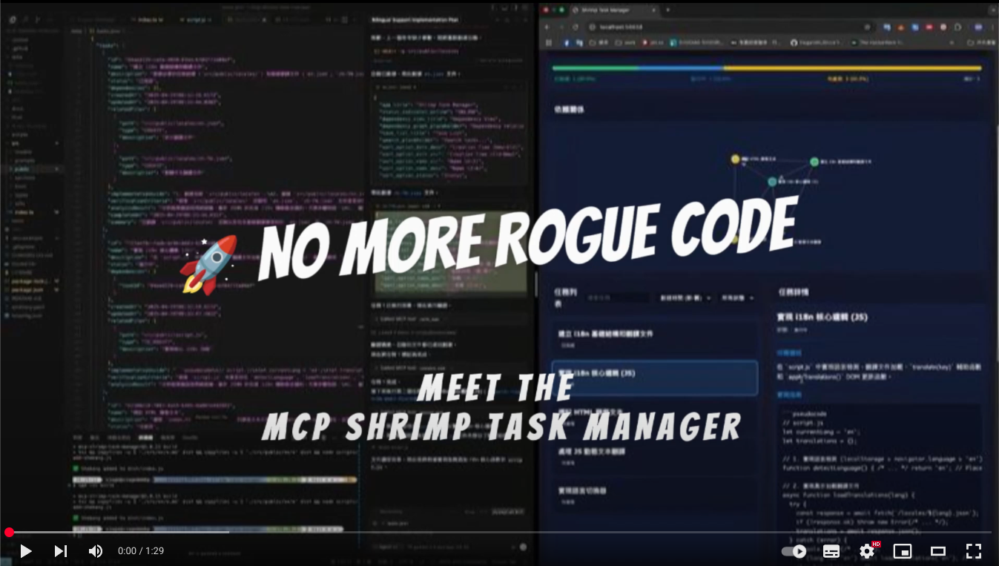
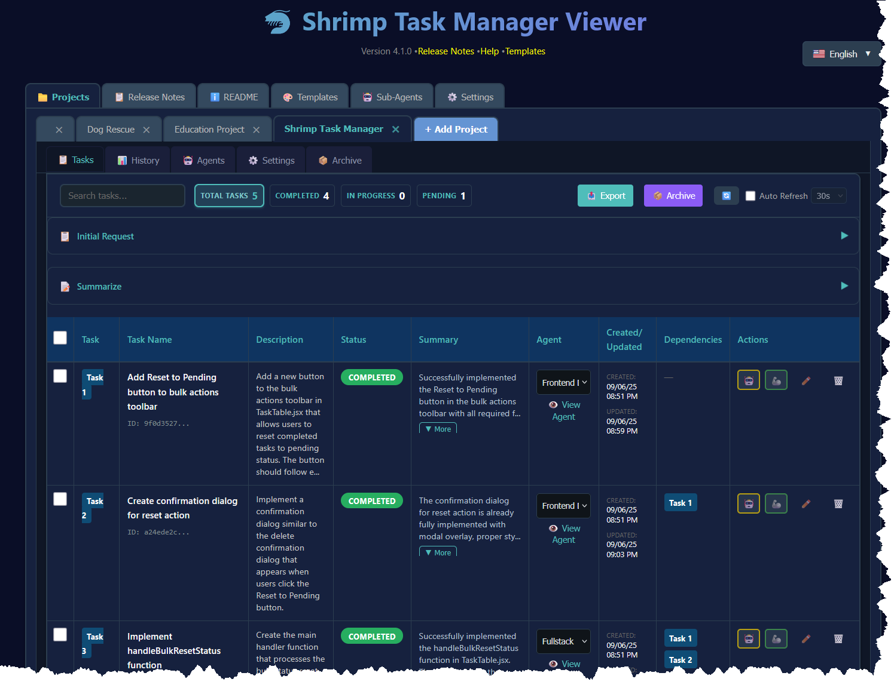

[🇺🇸 English](../../README.md) | [🇩🇪 Deutsch](../de/README.md) | [🇪🇸 Español](../es/README.md) | [🇫🇷 Français](../fr/README.md) | [🇮🇹 Italiano](../it/README.md) | [🇮🇳 हिन्दी](../hi/README.md) | [🇯🇵 日本語](../ja/README.md) | [🇰🇷 한국어](../ko/README.md) | [🇧🇷 Português](../pt/README.md) | [🇷🇺 Русский](README.md) | [🇨🇳 中文](../zh/README.md)

# MCP Shrimp Task Manager

> 🦐 **Интеллектуальное управление задачами для разработки с ИИ** - Разделяйте сложные проекты на управляемые задачи, сохраняйте контекст между сессиями и ускоряйте свой рабочий процесс разработки.

<div align="center">
  
[](https://www.youtube.com/watch?v=Arzu0lV09so)

**[Посмотреть демо-видео](https://www.youtube.com/watch?v=Arzu0lV09so)** • **[Быстрый старт](#-быстрый-старт)** • **[Документация](#-документация)**

[](https://smithery.ai/server/@cjo4m06/mcp-shrimp-task-manager)
<a href="https://glama.ai/mcp/servers/@cjo4m06/mcp-shrimp-task-manager"></a>

</div>

## 🚀 Быстрый старт

### Предварительные требования
- Node.js 18+ 
- npm или yarn
- MCP-совместимый ИИ клиент (Claude Code и др.)

### Установка

#### Установка Claude Code

**Windows 11 (с WSL2):**
```bash
# Сначала убедитесь, что WSL2 установлен (в PowerShell от имени администратора)
wsl --install

# Войдите в среду Ubuntu/WSL
wsl -d Ubuntu

# Установите Claude Code глобально
npm install -g @anthropic-ai/claude-code

# Запустите Claude Code
claude
```

**macOS/Linux:**
```bash
# Установите Claude Code глобально
npm install -g @anthropic-ai/claude-code

# Запустите Claude Code
claude
```

#### Установка Shrimp Task Manager

```bash
# Клонируйте репозиторий
git clone https://github.com/cjo4m06/mcp-shrimp-task-manager.git
cd mcp-shrimp-task-manager

# Установите зависимости
npm install

# Соберите проект
npm run build
```

### Настройка Claude Code

Создайте файл `.mcp.json` в директории вашего проекта:

```json
{
  "mcpServers": {
    "shrimp-task-manager": {
      "command": "node",
      "args": ["/путь/к/mcp-shrimp-task-manager/dist/index.js"],
      "env": {
        "DATA_DIR": "/путь/к/вашим/данным_shrimp",
        "TEMPLATES_USE": "ru",
        "ENABLE_GUI": "false"
      }
    }
  }
}
```

Пример конфигурации:
```json
{
  "mcpServers": {
    "shrimp-task-manager": {
      "command": "node",
      "args": ["/home/fire/claude/mcp-shrimp-task-manager/dist/index.js"],
      "env": {
        "DATA_DIR": "/home/fire/claude/проект/данные_shrimp",
        "TEMPLATES_USE": "ru",
        "ENABLE_GUI": "false"
      }
    }
  }
}
```

Затем запустите Claude Code с вашей пользовательской MCP конфигурацией:

```bash
claude --dangerously-skip-permissions --mcp-config .mcp.json
```

<details>
<summary><b>Другие ИИ клиенты</b></summary>

**Cline (Расширение VS Code)**: Расширение VS Code для программирования с помощью ИИ. Добавьте в VS Code settings.json под `cline.mcpServers`

**Claude Desktop**: Добавьте в `~/Library/Application Support/Claude/claude_desktop_config.json` (macOS) или `%APPDATA%\Claude\claude_desktop_config.json` (Windows)
</details>

### Начало использования

1. **Инициализируйте ваш проект**: `"init project rules"`
2. **Спланируйте задачу**: `"plan task: реализовать аутентификацию пользователя"`
3. **Выполните задачи**: `"execute task"` или `"continuous mode"`

## 💡 Что такое Shrimp?

Shrimp Task Manager - это MCP (Model Context Protocol) сервер, который преобразует подход ИИ агентов к разработке программного обеспечения. Вместо потери контекста или повторения работы, Shrimp предоставляет:

- **🧠 Постоянная память**: Задачи и прогресс сохраняются между сессиями
- **📋 Структурированные рабочие процессы**: Управляемые процессы для планирования, выполнения и проверки
- **🔄 Интеллектуальная декомпозиция**: Автоматически разбивает сложные задачи на управляемые подзадачи
- **🎯 Сохранение контекста**: Никогда не теряйте свое место, даже при ограничениях токенов

## ✨ Основные функции

### Управление задачами
- **Интеллектуальное планирование**: Глубокий анализ требований перед реализацией
- **Декомпозиция задач**: Разделение больших проектов на атомарные, тестируемые единицы
- **Отслеживание зависимостей**: Автоматическое управление отношениями между задачами
- **Мониторинг прогресса**: Отслеживание статуса и обновления в реальном времени

### Расширенные возможности
- **🔬 Режим исследования**: Систематическое изучение технологий и решений
- **🤖 Система агентов**: Назначайте специализированных ИИ агентов конкретным задачам ([Узнать больше](../agents.md))
- **📏 Правила проекта**: Определяйте и поддерживайте стандарты кодирования в вашем проекте
- **💾 Память задач**: Автоматическое резервное копирование и восстановление истории задач

### Веб-интерфейсы

#### 🖥️ Просмотрщик задач
Современный React интерфейс для визуального управления задачами с перетаскиванием, поиском в реальном времени и поддержкой нескольких профилей.

**Быстрая настройка:**
```bash
cd tools/task-viewer
npm install
npm run start:all
# Доступ по http://localhost:5173
```

[📖 Полная документация просмотрщика задач](../../tools/task-viewer/README.md)

<kbd></kbd>

#### 🌐 Веб GUI
Дополнительный легкий веб-интерфейс для быстрого обзора задач.

Включить в `.env`: `ENABLE_GUI=true`

## 📚 Документация

- [📖 Полная документация](../README.md)
- [🛠️ Доступные инструменты](../tools.md)
- [🤖 Управление агентами](../agents.md)
- [🎨 Настройка промптов](prompt-customization.md)
- [🔧 Справочник API](../api.md)

## 🎯 Распространенные случаи использования

<details>
<summary><b>Разработка функций</b></summary>

```
Агент: "plan task: добавить аутентификацию пользователя с JWT"
# Агент анализирует кодовую базу, создает подзадачи

Агент: "execute task"
# Реализует аутентификацию пошагово
```
</details>

<details>
<summary><b>Исправление ошибок</b></summary>

```
Агент: "plan task: исправить утечку памяти в обработке данных"
# Агент исследует проблему, создает план исправления

Агент: "continuous mode"
# Выполняет все задачи исправления автоматически
```
</details>

<details>
<summary><b>Исследование и обучение</b></summary>

```
Агент: "research: сравнить React vs Vue для этого проекта"
# Систематический анализ с плюсами/минусами

Агент: "plan task: мигрировать компонент на выбранный фреймворк"
# Создает план миграции на основе исследования
```
</details>

## 🛠️ Конфигурация

### Переменные окружения

Создайте файл `.env`:

```bash
# Обязательно
DATA_DIR=/путь/к/хранению/данных

# Опционально
ENABLE_GUI=true          # Включить веб GUI
WEB_PORT=3000           # Пользовательский веб-порт
PROMPT_LANGUAGE=ru      # Язык промптов (ru, en, zh и др.)
```

### Доступные команды

| Команда | Описание |
|---------|-------------|
| `init project rules` | Инициализировать стандарты проекта |
| `plan task [описание]` | Создать план задачи |
| `execute task [id]` | Выполнить конкретную задачу |
| `continuous mode` | Выполнить все задачи последовательно |
| `list tasks` | Показать все задачи |
| `research [тема]` | Войти в режим исследования |
| `reflect task [id]` | Проанализировать и улучшить задачу |

## 🤝 Вклад в проект

Мы приветствуем вклад! Пожалуйста, ознакомьтесь с нашим [Руководством по вкладу](../../CONTRIBUTING.md) для получения подробностей.

## 📄 Лицензия

Этот проект лицензирован под MIT License - см. файл [LICENSE](../../LICENSE) для подробностей.

## 🌟 Авторы

Создан [cjo4m06](https://github.com/cjo4m06) и поддерживается сообществом.

---

<p align="center">
  <a href="https://github.com/cjo4m06/mcp-shrimp-task-manager">GitHub</a> •
  <a href="https://github.com/cjo4m06/mcp-shrimp-task-manager/issues">Issues</a> •
  <a href="https://github.com/cjo4m06/mcp-shrimp-task-manager/discussions">Обсуждения</a>
</p>